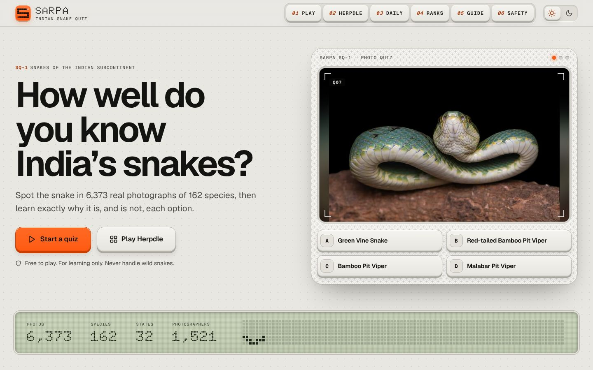
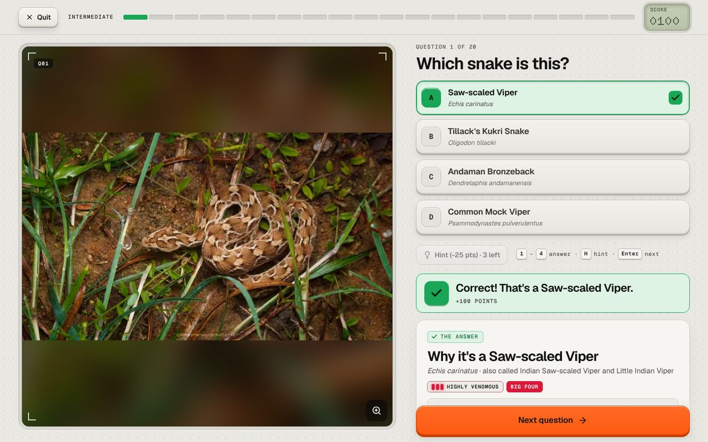
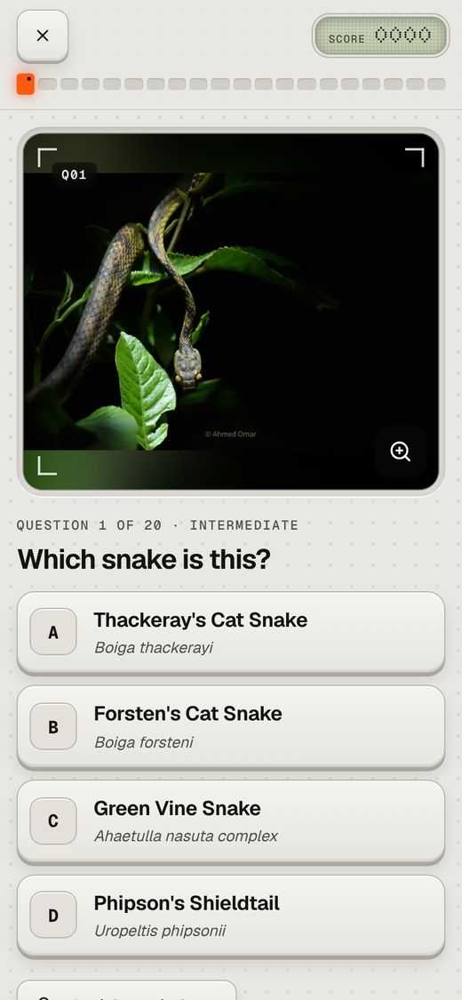
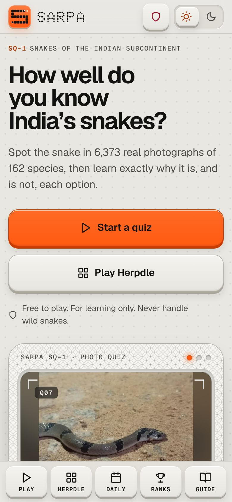
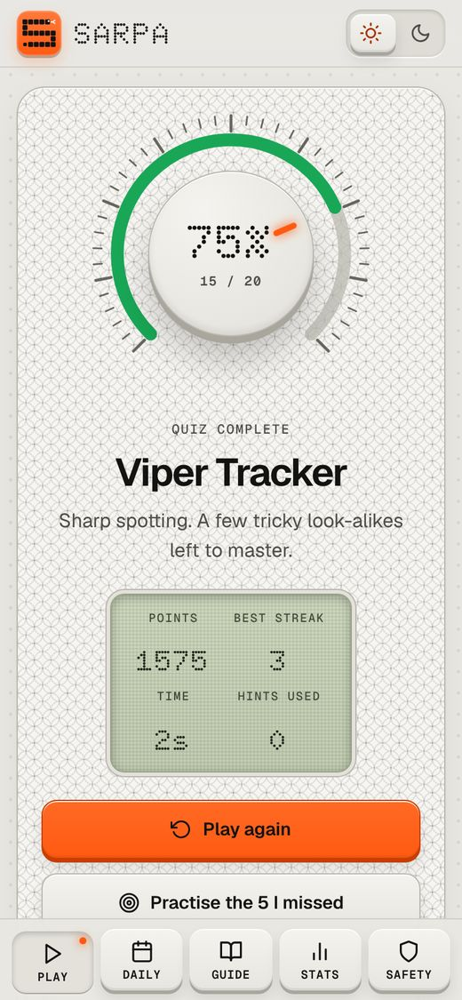
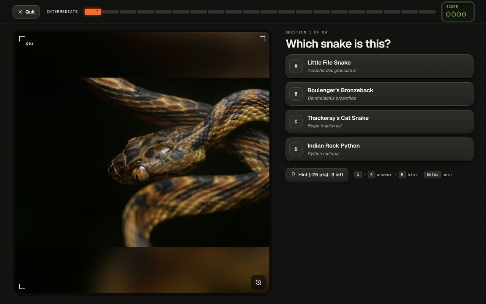
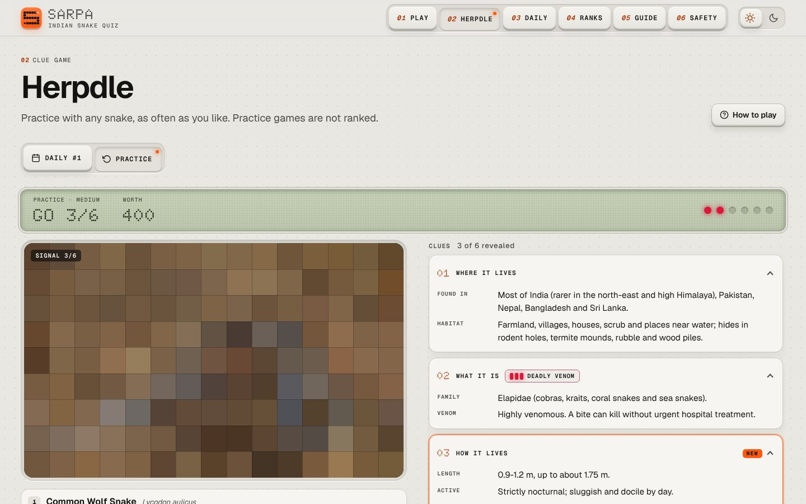
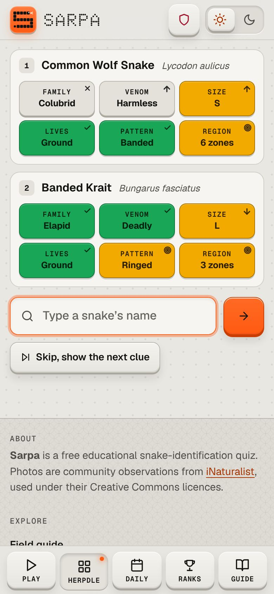
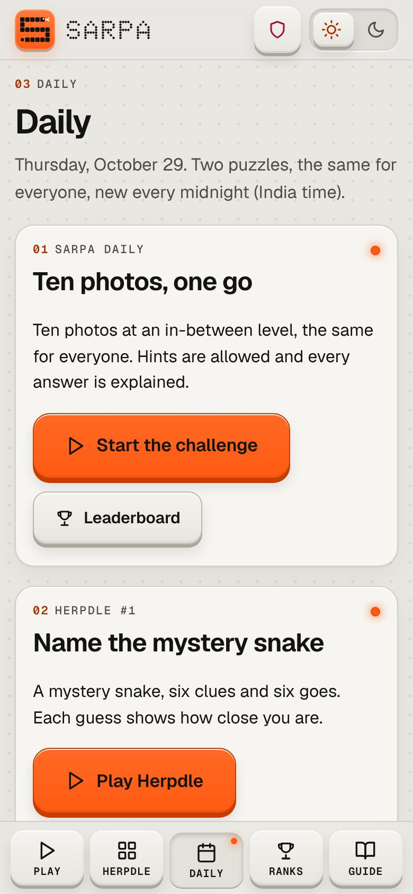

# Sarpa · Indian Snake Quiz

A free photo quiz that teaches you to recognise the snakes of India, and **explains every answer**. Two games:
**Sarpa**, the photo quiz, and **Herpdle**, a daily puzzle where you name a mystery snake from clues.

<p align="center">
  
  
</p>
<p align="center">
  
  
  
  
</p>
<p align="center">
  
  
  
</p>

You are shown a real photograph and four options. Whether you get it right or wrong, you then see
*why the right snake is right* **and** *why each of the other options is not*, with the key visual
differences and a side-by-side comparison.

It is a plain static website (HTML, CSS and JavaScript, **no build step**) plus one small serverless function
for accounts and leaderboards. Without the function (on GitHub Pages, any static host, or straight from the folder
on your computer) everything still works, just without accounts and leaderboards.

## Features

**Sarpa, the photo quiz**
- 20, 50 or 100 questions, four options each, or **Survival**: one mistake ends the run, and it gets harder as you go
- Four difficulty levels: *Beginner* (famous snakes, look-alikes kept apart), *Intermediate*, *Expert*
  (most options are genuine look-alikes) and *All species*
- Optional timer with bonus points for speed, hints (where the photo was taken, the snake's group and
  venom status, and a 50/50), streaks and points
- **Reasoning after every answer**: why it is the right snake, why each other option is wrong, how those
  snakes differ from the one in the photo, how dangerous each one is
- Every game is different: questions are built from thousands of photos, species are balanced, and photos
  you have already seen are avoided
- Fair by design: snakes that look identical in photographs (for example the newly split vine snakes) are
  grouped as one species or are never offered together
- Keyboard shortcuts (`1`–`4` or `A`–`D` to answer, `Enter` for next, `H` for a hint), works on phones

**Herpdle, the daily snake puzzle**
- One mystery snake a day, the same for everyone, and six goes to name it
- Six clues, one more after every guess (where it lives, venom, habits, looks, a tell-tale sign, a last clue); words
  that would give the name away are blacked out
- Every guess shows six tiles that say how close you are: family, venom, size, lifestyle, pattern and region of India
  (green = same, yellow = close, arrows for bigger/smaller and more/less venomous)
- A pixelated photo of the snake sharpens with every guess; a shareable result grid; practice mode with three levels

**Accounts and leaderboards**
- Make an account with just a **username and a 6-digit PIN** (no e-mail, no password rules, nothing else)
- Accounts are for the two games only (`requireAccountForGames` in [`js/config.js`](js/config.js)); the field guide,
  flashcards, safety pages and everything else never ask for one
- **Daily, weekly and all-time leaderboards** for the Sarpa daily challenge, Herpdle and quiz points, with your own
  place shown even when you are not in the top list; streaks and statistics on your profile
- Change your PIN, sign out everywhere, or delete the account and every score at any time

**Everything else**
- **Daily** page with both daily puzzles (new every midnight, India time), streaks and the last two weeks at a glance
- **Field guide** of all 162 species: identification tips, size, habitat, range, look-alikes, photo gallery with credits, where in India it was photographed
- **Compare tool**: pick any two snakes and see how they differ
- **Flashcards** for relaxed studying
- **Region filter**: quiz yourself on the snakes recorded in your own state
- **My progress**: stats, a snake-dex of species you have mastered, weak-spot practice, badges, and a backup/restore file
- **Snakebite first aid** (the national "Do it R.I.G.H.T." guidance), the "Big Four", and myths vs facts
- **Legal** pages: terms of use, privacy policy, safety disclaimer, photo licences and how to ask for a photo to be removed
- Dark mode, installable as an app, works offline after the first visit, no ads, no cookies and no tracking

## Design

Sarpa looks like a pocket field device: an aluminium case, orange keys that press down, a dot-matrix LCD for
the numbers, and small printed labels. The snake is in the details: the logo is a pixel snake, the quiz progress
bar is a snake's backbone (one segment per question, the head is the question you are on), a pixel snake crawls
across the home-page LCD, and the skin pattern, the diamond bullets and the serpentine rules all come from scales.

- fills the screen: two panes on wide screens (a big sticky photo beside the answers and explanation), a bottom
  key bar and thumb-friendly keys on phones, and a side-by-side layout for a phone held sideways
- light ("aluminium") and dark ("night shift") themes, and `prefers-reduced-motion` is respected
- fonts are bundled (Geist, Geist Mono and the dot-matrix Doto, all under the SIL Open Font Licence), so there are
  no external requests and the app still works offline

## Run it

```bash
node scripts/dev-server.js 8000           # website + accounts API with a temporary in-memory database
node scripts/dev-server.js 8000 --no-api  # website only, like a static host (guest play, no leaderboards)
```

Then open http://localhost:8000. No packages are needed (Node 18 or newer). `python3 -m http.server` also works
for the website alone.

### Put it online (Vercel, with accounts and leaderboards)

1. Import the repository in Vercel (no framework, no build command; the defaults are right). The website is served as
   static files and `api/sarpa.js` becomes the accounts API.
2. In the Vercel project open **Storage → Create Database → Upstash for Redis**, pick the free plan and connect it to
   the project (keep the suggested environment-variable prefix).
3. Recommended, **before anyone signs up**: in **Settings → Environment Variables** add `PIN_PEPPER` with a long
   random value (for example the output of `openssl rand -hex 32`). Never change it later, or every PIN stops
   working. Optional: `IP_SALT` (another random value) and `ADMIN_TOKEN` (16+ characters, to remove an abusive
   username with the `admin-delete` action).
4. Redeploy. `https://<your-site>/api/sarpa?action=health` should now say `"accounts": true`.
5. Optional: put the operator's name and contact e-mail in [`js/config.js`](js/config.js); the legal pages use them.

Without step 2 the site still works: the games are played as a guest and are not ranked.

### Put it online (GitHub Pages or any static host, without accounts)

1. In the repository go to **Settings → Pages → Build and deployment → Source** and choose **GitHub Actions**.
2. Merge to `main`. The workflow in `.github/workflows/pages.yml` publishes the site automatically.

Any other static host (Netlify, Cloudflare Pages, an S3 bucket, your own server) works as well: upload
`index.html`, `sw.js`, `manifest.webmanifest`, `css/`, `js/`, `data/*.js`, `assets/` and `images/`.

### Link previews

When the link is pasted into WhatsApp, X, Facebook, LinkedIn, Slack and similar apps, they show a card with
[`assets/social-preview.jpg`](assets/social-preview.jpg). These apps need full addresses, so the tags at the top of
`index.html` name `https://snakes-quiz.vercel.app`: on another domain, change those addresses. The apps remember a
link's preview for a while, so to see a change straight away, share the address with something added, such as
`https://snakes-quiz.vercel.app/?v=2`. `scripts/assets/make-social-preview.js` redraws the image.

### How the accounts work

- A PIN is never stored: the server keeps a salted scrypt hash. Sessions are random tokens, stored only as hashes,
  and end after 180 days without use. Wrong PINs and sign-ups are rate-limited per account and per (hashed) address.
- Scores are worked out by the server from the answers, not taken from the browser. The daily puzzles come from the
  server's schedule (`server/generated/data.json`, made by `scripts/dataset/10_server_data.js` with the website's
  own code), each account can play each daily once, and impossible timings are refused. As in any browser game,
  a determined cheat can still read the answers from the website's code, so the boards are for fun.
- The database holds usernames, PIN hashes, game results and leaderboard entries; old results expire (see the
  privacy page). There are no cookies, ads or analytics.

## The photo data set

The photographs are **real, community-identified observations from [iNaturalist](https://www.inaturalist.org)**:

- only *research grade* observations (other naturalists agreed with the species identification)
- only photos taken **in India**, labelled with the state they were taken in
- only photos whose photographer chose an open **Creative Commons** licence
- cleaned in three ways: an image classifier removes photos where no snake is clearly visible, a person
  looked at the candidate photos on contact sheets and removed unusable ones (dead or crushed animals, a
  speck in a landscape, shed skins, collages ...), and near-duplicates are dropped. Awkward but identifiable
  photos are kept, flagged *hard*, and only shown at the harder levels

Every photo is credited under the picture, in the in-app **Photo credits** page and in
[`CREDITS.md`](CREDITS.md) / [`data/catalog.csv`](data/catalog.csv).

`scripts/dataset` rebuilds the whole set from iNaturalist's public open-data bucket, so you can regenerate it,
widen it (more species, more photos per species) or restrict it to commercially usable licences. See
[`scripts/dataset/README.md`](scripts/dataset/README.md).

> **Licensing note.** Many photographers use *CC BY-NC*, so the photos as shipped are for **non-commercial**
> use. If you want to monetise the site, rebuild the data with `--commercial-ok` (CC0 / CC BY / CC BY-SA only).

## The species knowledge base

All the teaching content lives in [`data/kb`](data/kb) as plain JSON, one file per group of species:

| field | meaning |
| --- | --- |
| `id`, `sci`, `name`, `aka`, `local` | names (common, scientific, other English names, local-language names) |
| `family`, `kind`, `tier` | family, an everyday group name, and identification difficulty 1 (easy) to 5 (very hard) |
| `venom`, `big4` | `deadly`, `venomous`, `mild` (rear-fanged) or `none`; one of the "Big Four" |
| `len`, `habitat`, `range`, `diet`, `active` | quick facts |
| `ids` | the "how to identify it" bullet points |
| `look` | short phrases (colour, pattern, head, body) used in side-by-side tables |
| `t` | machine-readable traits (hood, head, snout, pupil, scales, build, size, habit, pattern, hue) used to work out *what differs* between two snakes and which options are look-alikes |
| `grp` | look-alike groups used to choose tricky options |
| `inat` | the iNaturalist names that count as this species (to merge cryptic species) |
| `fact` | a "did you know?" line |

`_pairs.json` holds hand-written notes for the most confusable pairs (`pairs`) and sets of species that cannot be
told apart from a photo (`noPair`, never asked together). Where no hand-written note exists, the app writes the
"why not" explanation itself from the traits.

To add or fix a species, edit the JSON and run `scripts/dataset/09_build_data.py` (it validates the file).

> The descriptions are written for general education from standard field-guide knowledge. They are not
> peer-reviewed, so please report mistakes (an issue or pull request is perfect).

## Quality checks

With the site served on port 8765 (`node scripts/dev-server.js 8765`, add `--no-api` to test guest play) and
Playwright installed:

```bash
node scripts/qa/api_test.js       # the accounts API against an in-memory database: sign-up, PINs, sessions, rate limits,
                                  # daily puzzles, scoring, anti-cheat checks, leaderboards, deleting an account
node scripts/qa/engine_check.js   # 4,500+ generated questions: 4 unique options, right answer, no look-alike clashes, balance...
node scripts/qa/smoke.js          # every page and species page: no stray "null"/"undefined", no errors, no broken photos;
                                  # the link-preview tags and image
node scripts/qa/e2e.js            # 50-step run-through: account sign-up, timer, hints, explanations, reload-and-resume,
                                  # results, daily parity between two players, region filter, reporting a photo, phone
                                  # layout, Herpdle
node scripts/qa/layout.js         # design checks on every page at phone, tablet, laptop and ultrawide sizes, light and dark:
                                  # nothing overflows or is clipped, tap targets, WCAG contrast, broken images, tab bar overlap
                                  # (--quick for fewer sizes, --shots <dir> to save screenshots)
node scripts/qa/a11y.js           # axe-core accessibility scan of every page (WCAG 2.2 AA); first: npm install --no-save axe-core
```

## Project layout

```
index.html  sw.js  manifest.webmanifest
css/                                styling: fonts.css, tokens.css (colours, type, space; light + dark),
                                    base.css (page frame, header, tab bar), components.css (keys, LCD, panels ...),
                                    views.css (every screen), games.css (Herpdle, accounts, leaderboards)
js/                                 the app: engine (question building), explain (why-not logic), quiz, guide, results,
                                    herpdle-core + herpdle (the clue game), api + account (accounts), ranks, legal ...
js/config.js                        site settings: API address, accounts on/off, who runs the site (for the legal pages)
api/sarpa.js                        the Vercel serverless function (accounts and leaderboards); its code is in server/
server/                             the API: app (actions), auth (PINs, sessions), games (scoring, boards), store (Upstash)
server/generated/data.json          species, photos and the daily puzzles the server checks against (generated)
data/kb/*.json                      the species knowledge base (hand-written)
data/species.js  data/photos.js     generated for the app by scripts/dataset/09_build_data.py
data/catalog.csv                    every photo with species, state, photographer, licence and source link
images/<species>/<photo-id>.avif    the photos (800 px, AVIF) and images/thumbs/ for the cover pictures
assets/                             app icons and the link-preview image (drawn by scripts/assets/) and the bundled fonts
scripts/dataset/                    the data-set pipeline (iNaturalist open data -> photos -> server schedule)
scripts/dev-server.js               a local server for the website and the API
scripts/qa/                         API and browser-based tests
```

## Safety

Identifying a snake from a photo is a learning game, **not a safety tool**. Never touch, corner or try to catch a
wild snake. After a bite, go to a hospital immediately (the app has a first-aid page).

## Licences and credits

- Code: [MIT](LICENSE)
- Fonts: Geist, Geist Mono and Doto, [SIL Open Font Licence 1.1](assets/fonts/OFL.txt)
- Species descriptions (`data/kb`): CC BY 4.0
- Photographs: © their photographers, under the Creative Commons licence shown with each photo
  (see [`CREDITS.md`](CREDITS.md))
- State names are derived from each photo's location using OpenStreetMap-based boundaries © OpenStreetMap contributors
